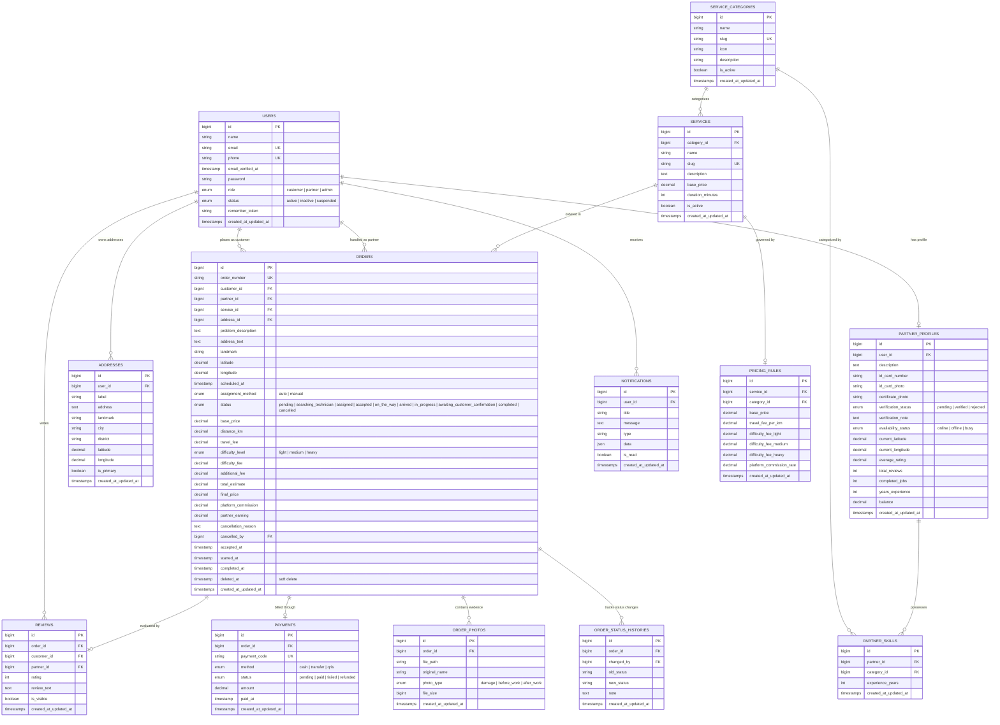

# DATABASE ARCHITECTURE & ENTITY-RELATIONSHIP DIAGRAM (ERD)
## BetulinAja — Marketplace Jasa Service & Perbaikan Rumah

Dokumen ini memuat spesifikasi arsitektur basis data, Entity-Relationship Diagram (ERD), skema tabel, indeks relasional, serta panduan migrasi basis data cloud persisten.

---

## 1. Visual Entity-Relationship Diagram (Mermaid)



---

## 2. Aturan Bisnis & Rumus Kalkulasi

### Formula Penentuan Tarif Total
Perhitungan estimasi biaya perbaikan menggunakan formula berjenjang:
$$\text{Total Estimate} = \text{Base Price} + (\text{Distance Km} \times \text{Travel Fee per Km}) + \text{Difficulty Surcharge} + \text{Additional Fee}$$

- **Travel Fee per Km:** Default Rp5.000 / km berdasarkan kalkulasi jarak Haversine bola bumi.
- **Difficulty Surcharge:**
  - `light` (Ringan): Rp0
  - `medium` (Sedang): Rp25.000
  - `heavy` (Berat): Rp60.000
- **Bagi Hasil Finansial:**
  - Komisi Platform (`platform_commission`): 15% dari `final_price`
  - Hak Pendapatan Mitra (`partner_earning`): 85% dari `final_price`

### Siklus Status Pesanan (Order Lifecycle State Machine)
Setiap pesanan dijamin mengikuti transisi yang valid melalui `Order::VALID_TRANSITIONS`:
1. `pending` $\rightarrow$ `searching_technician` atau `cancelled`
2. `searching_technician` $\rightarrow$ `assigned` atau `cancelled`
3. `assigned` $\rightarrow$ `accepted`, `searching_technician` (bila ditolak mitra), atau `cancelled`
4. `accepted` $\rightarrow$ `on_the_way` atau `cancelled`
5. `on_the_way` $\rightarrow$ `arrived`
6. `arrived` $\rightarrow$ `in_progress`
7. `in_progress` $\rightarrow$ `awaiting_customer_confirmation` atau `completed`
8. `completed` (Selesai, saldo mitra dikreditkan, ulasan aktif)
9. `cancelled` (Dibatalkan)

---

## 3. Panduan Menjalankan Migrasi & Database Cloud

### Opsi 1: Cloud MySQL (Aiven / PlanetScale / Railway MySQL / Clever Cloud)
1. Buat database MySQL di penyedia cloud.
2. Tambahkan kredensial ke `.env`:
   ```dotenv
   DB_CONNECTION=mysql
   DB_HOST=your-mysql-cloud-host.com
   DB_PORT=3306
   DB_DATABASE=betulinaja
   DB_USERNAME=your_username
   DB_PASSWORD=your_secure_password
   ```

### Opsi 2: Cloud PostgreSQL (Supabase / Neon.tech / Railway PostgreSQL)
1. Salin connection string dari dashboard Supabase atau Neon.
2. Tambahkan kredensial ke `.env`:
   ```dotenv
   DB_CONNECTION=pgsql
   DB_HOST=ep-example.neon.tech
   DB_PORT=5432
   DB_DATABASE=neondb
   DB_USERNAME=neondb_owner
   DB_PASSWORD=your_neon_password
   ```

### Menjalankan Migration & Seeding
```bash
# Jalankan migrasi seluruh tabel
php artisan migrate

# Isi data awal demo pengguna, kategori, layanan, dan contoh transaksi
php artisan db:seed

# Cek status tabel
php artisan db:show
```
